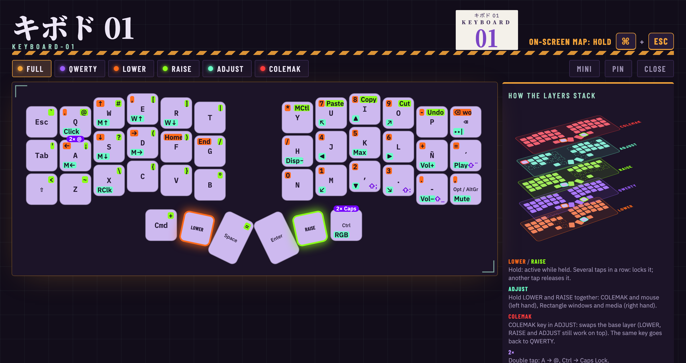
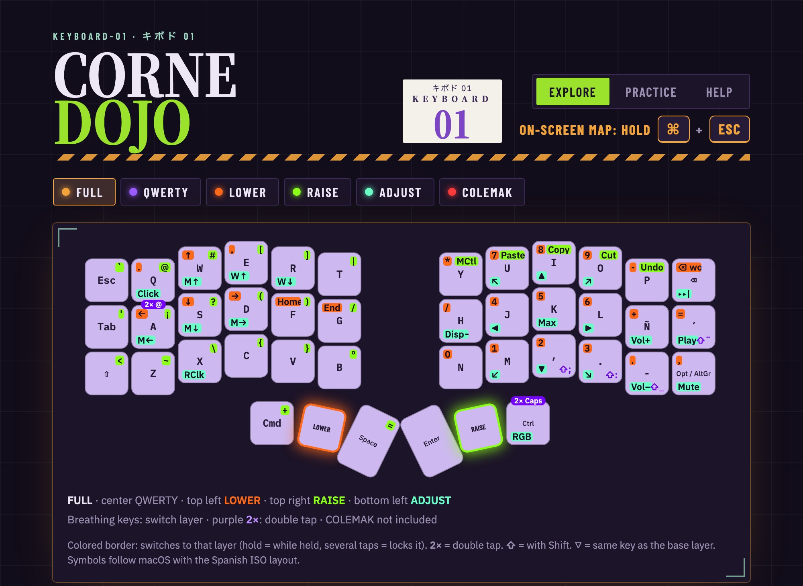
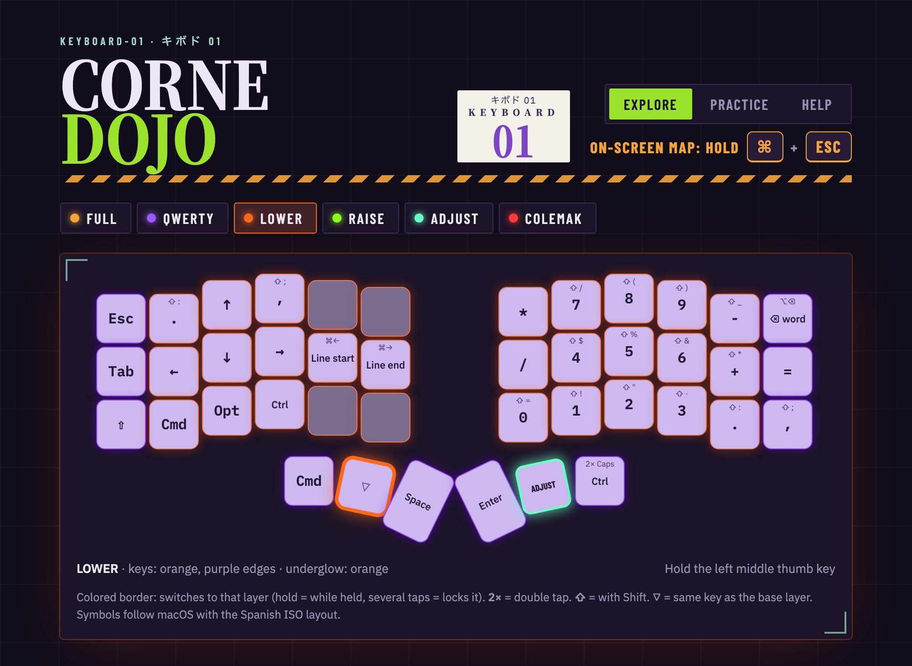
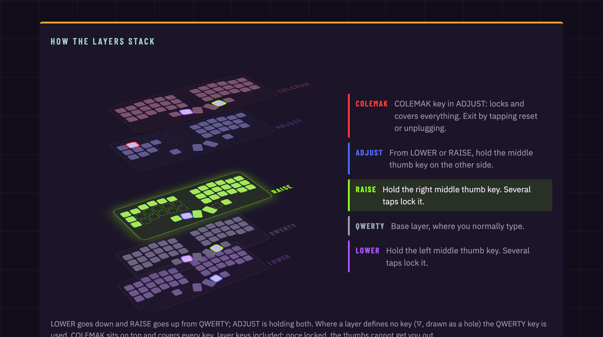
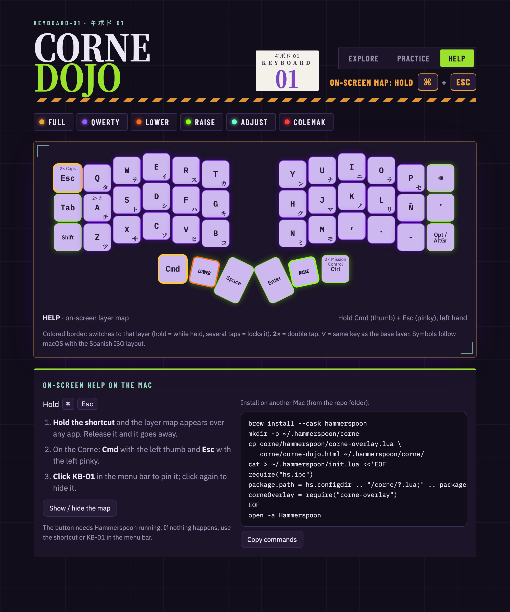
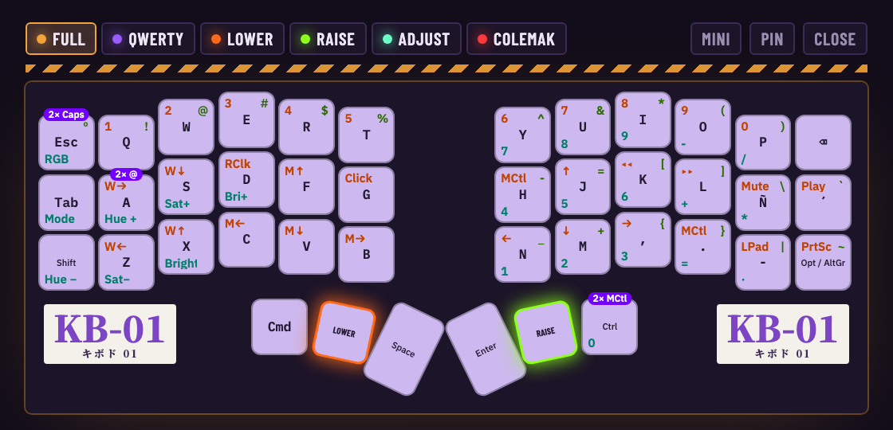
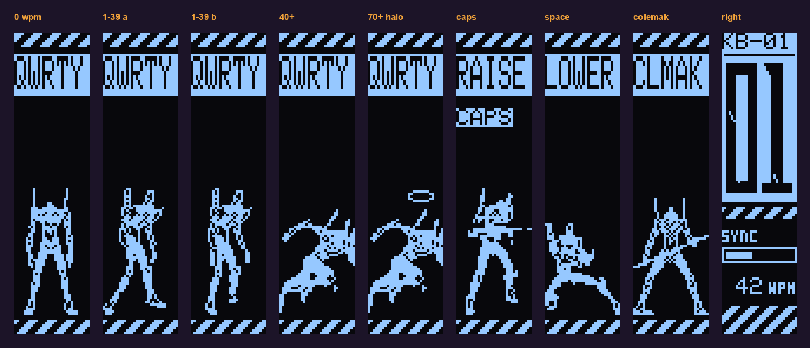

<div align="center">

# KEYBOARD-01

### An opinionated Corne rev1 with QMK customization and on-screen help for Mac

<sub>キボド 01 · EVA-01 palette · Miryoku-style layers · animated OLED</sub>

<br>


<br>

**42 keys. Five layers. Zero guessing.**<br>
Every symbol, number, arrow, window shortcut and media key sits one thumb away, and when you forget where,<br>
hold <kbd>⌘</kbd> + <kbd>Esc</kbd> and the whole keyboard appears on screen.

<br>

<a href="https://thmaureira.github.io/keyboard-01/"></a>

<br><br>

<a href="https://thmaureira.github.io/keyboard-01/"></a>

</div>

---

## Highlights

| | |
|---|---|
| **FULL view** | Every layer on every key, color-coded: LOWER orange, RAISE green, ADJUST cyan, double taps purple |
| **On-screen help** | <kbd>⌘</kbd> <kbd>Esc</kbd> opens the map on the Mac, switching to whatever layer the keyboard reports |
| **Corne Dojo** | Web trainer to learn the layers by typing, [online](https://thmaureira.github.io/keyboard-01/) |
| **Miryoku-inspired** | Numpad and arrows on LOWER, symbols on RAISE, mouse, Rectangle windows and media on ADJUST |
| **EVA-01 OLED** | The unit stands, walks, sprints, crouches, fires and draws the lance as you type |

Configuration of my Corne (foostan crkbd, QMK, Pro Micro), recovered by reading the firmware that was on the keyboard.

## Gallery

| Corne Dojo (FULL) | One layer (LOWER) |
|---|---|
|  |  |
| **Layers stacked in 3D** | **Help: ⌘ Esc shortcut** |
|  |  |
| **⌘ Esc thumbnail (Mini)** | |
|  | |

## Layers

| Layer | How to activate | LEDs | Contents |
|---|---|---|---|
| **QWERTY** | base layer | EVA purple, lime green edges | Letters. Double tap `A` = `@`, double tap `Ctrl` = Caps Lock. ⇧ legends show what a key gives with Shift (`,` → `;`, `.` → `:`, `-` → `_`) |
| **LOWER** | hold the left middle thumb key | orange, purple edges | Right hand: numpad (`7 8 9 / 4 5 6 / 0 1 2 3` with `* / - + = . ,`; Shift gives `! " · $ % & / ( ) =`). Backspace deletes a word (⌥⌫). Left hand: arrows (↑ on W, ← ↓ → on A S D) with `.` on Q and `,` on E, line start/end (⌘← ⌘→) on F G, ⌘ ⌥ ⌃ |
| **RAISE** | hold the right middle thumb key | lime green, purple edges | Left hand: symbols `` ` @ # [ ] \| ' ¡ ? ( ) / < ~ \ { } º + = `` (Shift: `^ ¿ > * ª`). Right hand: Mission Control, paste, copy, cut, undo (top row) and ⇧ ⌃ ⌥ ⌘ |
| **ADJUST** | from LOWER or RAISE, hold the middle thumb key on the other side | mint, orange edges | Left hand: COLEMAK (on Esc), mouse (↑ on W, ← ↓ → on A S D), click on Q, wheel ↑ ↓ on E R, right click on X. Right hand: [Rectangle](https://rectangleapp.com) window shortcuts (⌃⌥ U ↑ I / ← ⏎ → / J ↓ K, ⌃⌥⌘→), next track, play, volume, mute. RGB on/off |
| **COLEMAK** | in ADJUST, the `COLEMAK` key (where Esc is) swaps the base; the same key goes back | QWERTY colors, Esc and Backspace breathe red | Colemak layout |

The layers follow [Miryoku](https://github.com/manna-harbour/miryoku): each one is held with one thumb and its keys sit on the other hand, which keeps the modifiers. All LEDs breathe slowly (KB-01 firmware). Layer keys are *tap-toggle*: holding one activates the layer while held; tapping it several times in a row locks it. Symbols assume macOS with the **Spanish ISO** layout.

## On-screen help on the Mac (⌘ Esc)

Opens Corne Dojo in a window above any app, without recompiling the keyboard.

- **Hold `⌘ Esc`**: the window appears; release and it disappears. On the Corne: Cmd with the left thumb and Esc with the left pinky 
- **Pin** (in the window) or **click `KB-01`** in the menu bar: keeps it open. **Close** or `Esc` hides it.
- **Mini**: pins a small translucent thumbnail in the bottom-right corner (at most 40 % of the screen width). Drag it from anywhere that is not a button; it remembers where you left it. **Large** goes back to the normal size.
- It opens in the last size you used (Mini or Large).
- With the window pinned, the tabs (or keys `1`–`6`) show only that layer. It always opens on **FULL**.
- **FULL** (first tab) shows every layer on the same key, like [Miryoku](https://github.com/manna-harbour/miryoku): QWERTY in the center, LOWER top left (orange), RAISE top right (green), ADJUST bottom left (mint); held modifiers are left out. COLEMAK is left out because it replaces the base. Keys that switch layer breathe in the color of the layer they open, and a purple `2×` tag marks the double taps (A → @, Ctrl → Caps Lock).

Install (once):

```sh
brew install --cask hammerspoon
mkdir -p ~/.hammerspoon/corne
cp corne/hammerspoon/corne-overlay.lua corne/corne-dojo.html ~/.hammerspoon/corne/
cat > ~/.hammerspoon/init.lua <<'EOF'
require("hs.ipc")
package.path = hs.configdir .. "/corne/?.lua;" .. package.path
corneOverlay = require("corne-overlay")
EOF
open -a Hammerspoon
```

To change the shortcut, edit the line `hs.hotkey.bind({ "cmd" }, "escape", ...)` in `corne-overlay.lua` and restart Hammerspoon.

## What the Japanese means

The style is inspired by *Evangelion*'s EVA-01. The keyboard is called **KB-01** (KEYBOARD-01).

| Text | Reading | Meaning |
|---|---|---|
| **キボド 01** | *kibodo zero-wan* | "Keyboard 01", shortened. The Japanese name of KB-01 |
| キ | *ki* | syllable "ki" |
| ボ | *bo* | syllable "bo" (ホ *ho* with the two ticks ゛ that make it voiced) |
| ド | *do* | syllable "do" (ト *to* with ゛) |

キボド is "keyboard" in katakana, clipped: the full form is キーボード (*kībōdo*), where `ー` lengthens the previous vowel.

### Katakana on the keys (QWERTY)

These are the kana printed on Japanese keycaps (JIS layout for kana input). Each one is a syllable, not a word, so on their own they mean nothing.

| Key | Kana | Syllable | | Key | Kana | Syllable | | Key | Kana | Syllable |
|---|---|---|---|---|---|---|---|---|---|---|
| Q | タ | ta | | A | チ | chi | | Z | ツ | tsu |
| W | テ | te | | S | ト | to | | X | サ | sa |
| E | イ | i | | D | シ | shi | | C | ソ | so |
| R | ス | su | | F | ハ | ha | | V | ヒ | hi |
| T | カ | ka | | G | キ | ki | | B | コ | ko |
| Y | ン | n | | H | ク | ku | | N | ミ | mi |
| U | ナ | na | | J | マ | ma | | M | モ | mo |
| I | ニ | ni | | K | ノ | no | | | | |
| O | ラ | ra | | L | リ | ri | | | | |
| P | セ | se | | | | | | | | |

## Web trainer (Corne Dojo)

`corne/corne-dojo.html` (open it in a browser; the same page is in `docs/index.html` for GitHub Pages). It opens on FULL and, below, shows the layers stacked in 3D (click one to see it). It lights up the key and layer of what you type, and has a practice mode that repeats the characters you struggle with more often. Published at https://claude.ai/artifact/FbiRLyb5SXwaoRFzvND5iT

## Files

| File | What it is |
|---|---|
| `corne/keymap.c` | Keymap recovered from the original firmware (without the Luna/OLED code, which is compiled) |
| `corne/corne_dump.hex` | Exact copy of the firmware; can be flashed back as is |
| `corne/corne_eeprom.hex` | Copy of the EEPROM (saved RGB settings) |
| `corne/led-colors.json` | Key and underglow color for each layer (the KB-01 EVA palette) |
| `corne/tools/led_colors.py` | Generates those colors (keys = layer color, modifier keys = shifted hue) and applies them to the YAML and diagram config |
| `corne/tools/build_dojo.py` | Builds `corne-dojo.html` and `docs/index.html` from the template, the KB-01 keymap (`qmk/kb01/keymap.c`) and `led-colors.json` |
| `corne/tools/keymap_yaml.py` | Writes the layer legends of `keymap.yaml` from the Dojo (headless Chrome), so both label keys the same way |
| `corne/tools/full_layer.py` | Adds the FULL layer to the YAML and marks the layer keys so they breathe |
| `corne/img/` | Screenshots of the Dojo, the ⌘ Esc window and the OLED |
| `corne/qmk/kb01/` | KB-01 QMK keymap: `keymap.c`, `eva_sprites.h` (OLED sprites), `rgb_matrix_user.inc` (breathing effect) |
| `corne/qmk/kb01.hex` | KB-01 compiled firmware |
| `docs/index.html` | Corne Dojo for GitHub Pages |
| `corne/keymap.yaml` | Diagram source for [keymap-drawer](https://github.com/caksoylar/keymap-drawer) |
| `corne/drawer-config.yaml` | Per-layer colors (the firmware's) and the shortcut note |
| `corne/keymap.svg` | Layer diagram |
| `corne/hammerspoon/corne-overlay.lua` | On-screen help: opens `corne-dojo.html#overlay` with ⌘ Esc |
| `corne/trainer.template.html` | Web trainer source (the keymap is inserted at `__LAYERS__`) |

## Regenerating the diagrams

```sh
pip install keymap-drawer
python corne/tools/build_dojo.py
python corne/tools/keymap_yaml.py  # layer legends from the Dojo (needs Google Chrome)
python corne/tools/full_layer.py   # FULL layer and layer keys (use the Python where keymap-drawer is installed)
python corne/tools/led_colors.py   # per-key colors
python corne/tools/build_dojo.py   # again, with the new colors
keymap -c corne/drawer-config.yaml draw corne/keymap.yaml > corne/keymap.svg
cp corne/corne-dojo.html ~/.hammerspoon/corne/   # the ⌘ Esc window uses the same Dojo
```

## New firmware (KB-01)

`corne/qmk/kb01/` is a QMK keymap rebuilt from the recovered one, with an EVA-01 OLED and LED palette:

- **COLEMAK no longer traps you**: the `COLEMAK` key in ADJUST swaps the base layer, so LOWER, RAISE and ADJUST keep working on top of Colemak and the same key goes back to QWERTY. Unplugging always starts on QWERTY.
- **Layer report to the Mac**: every layer change taps F16 (base), F17 (LOWER), F18 (RAISE), F19 (ADJUST) or F20 (COLEMAK). The ⌘ Esc window switches to that layer and swallows the keys (Hammerspoon needs Accessibility permission).
- **Two taps lock a layer** (`TAPPING_TOGGLE 2`).
- **Miryoku-style layers** (see the table above) with single keys for the Rectangle and editing shortcuts.
- **EVA LEDs**: a custom effect (`EVA_BREATH`) makes every LED breathe in the layer color; modifiers get a shifted hue. On COLEMAK, Esc and Backspace breathe red.

### OLED



- **Left half**: the layer name, `CAPS` when Caps Lock is on and an EVA-01 silhouette that follows your typing speed. It faces the front when idle, walks under 40 wpm, sprints from 40 and gets a halo from 70. Space makes it crouch, Caps Lock makes it hold the rifle (every key fires a bullet) and on COLEMAK it carries the lance.
- **Right half**: the KB-01 plate and a SYNC bar, where 100 wpm is full sync, with the wpm below.

The sprites in `eva_sprites.h` are traced from reference figures and stored as 32 px wide OLED pages.

To fit in 28 KB, features the keymap does not use are compiled out: one-shot keys, 32-bit layer state, the other RGB effects (except Breathing) and LED state sync between halves.

`corne/qmk/kb01.hex` is the compiled firmware (27,006 of 28,672 bytes). Build it again with:

```sh
brew tap osx-cross/avr && brew install avr-gcc@8
python3 -m pip install qmk
git clone --depth 1 https://github.com/qmk/qmk_firmware ~/qmk_firmware
ln -s "$PWD/corne/qmk/kb01" ~/qmk_firmware/keyboards/crkbd/keymaps/kb01
cd ~/qmk_firmware && make crkbd/rev1:kb01   # -> crkbd_rev1_kb01.hex
```

Flash **both halves**, one at a time, each with its own USB cable: double tap reset and within 8 s

```sh
avrdude -p atmega32u4 -c avr109 -P /dev/cu.usbmodemXXXX -U flash:w:corne/qmk/kb01.hex:i
```

The left half is the one that goes to the computer (`MASTER_LEFT`). On the Mac, set the input source to **Spanish ISO**. To go back, flash `corne/corne_dump.hex` (below) on both halves.

## Recovering or restoring the firmware

With the left half connected, double tap the reset button and within 8 s:

```sh
# read (changes nothing)
avrdude -p atmega32u4 -c avr109 -P /dev/cu.usbmodemXXXX -U flash:r:corne_dump.hex:i
# restore the backup
avrdude -p atmega32u4 -c avr109 -P /dev/cu.usbmodemXXXX -U flash:w:corne/corne_dump.hex:i
```

## Layer map


The first layer of the diagram, **FULL**, puts every layer on each key: QWERTY in the center, LOWER top left, RAISE top right, ADJUST bottom left and the double taps (`2×`) in purple. Keys that switch layer breathe in the color of the layer they open (when the SVG is opened in a browser).
